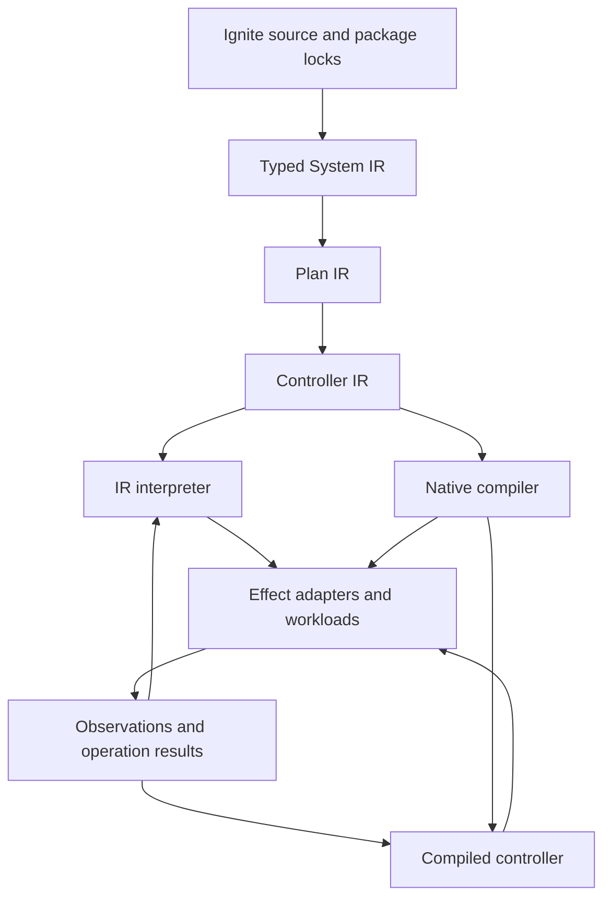
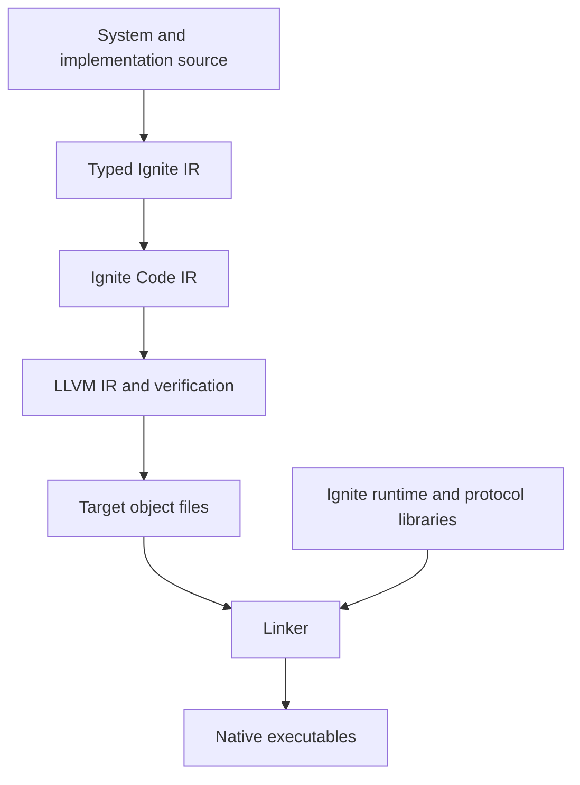
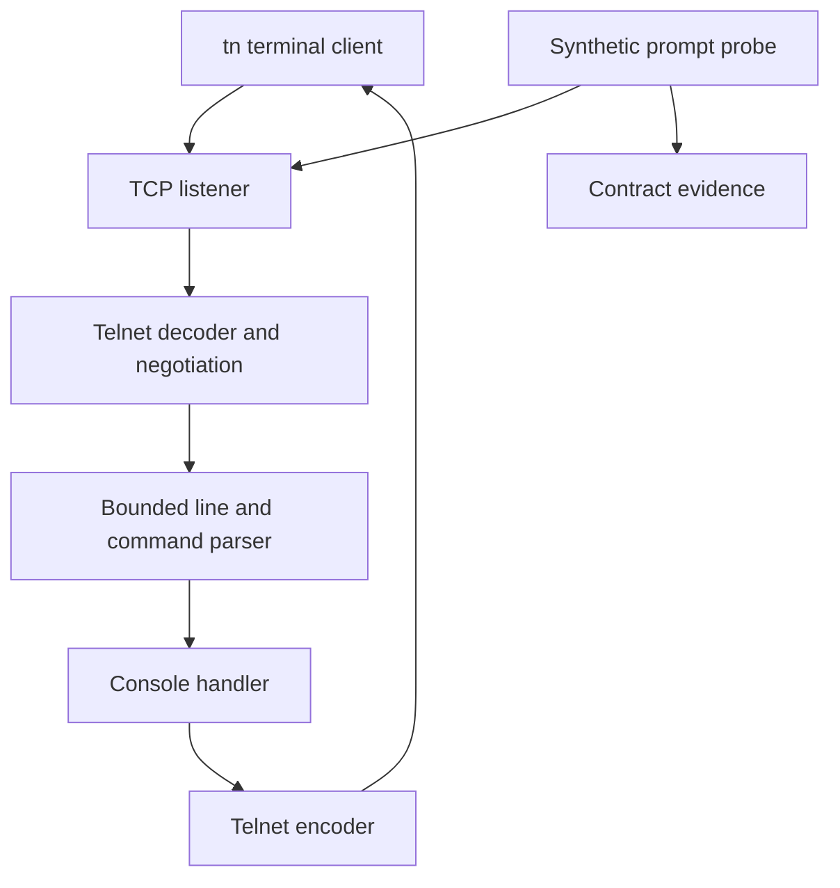
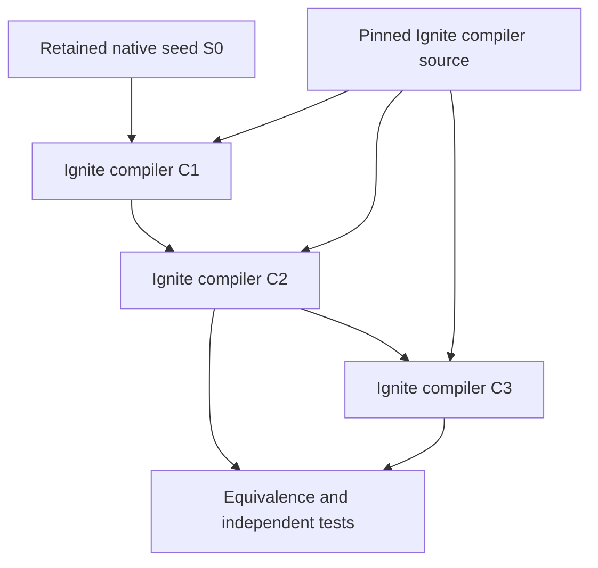

# Ignite

## Product requirements and language design

**Status:** Proposed design, version 0.3  
**Date:** 1 November 2026  
**Changes in 0.3:** status paragraph and §11.2 (an implementation exists), §3.2 (`protocol`, `const`, `test`), §3.3 (`Text` replaces `String`), §8.1 and §8.10 (two native targets), §8.6 (tokio, protocols in Ignite, rustls), §8.7 and §8.8 (no `await`).  
**Scope:** Product requirements, language primitives, executable specifications, runtime, native compilation, terminal reference system, and roadmap to self-hosting.

Ignite is an intent-oriented language for specifying, building, deploying, and operating systems. A program declares components, resources, connections, operational objectives, contractual commitments, and the actions permitted to maintain them. A compiler lowers that program into an executable specification. An interpreter executes the specification first; a native backend later produces specialized controllers and compatible application executables.

The design has two related surfaces: a declarative system language and a deliberately small implementation language. System declarations describe topology and intent. Typed functions implement reusable transformations, policies, application modules, and eventually the compiler itself. Effects remain explicit in both surfaces.

This document consolidates and supersedes the earlier unnamed language proposal for this conversation. It proposes behavior and acceptance criteria. A compiler for a subset of the implementation language exists in this repository, with two native targets, a standard library in Ignite and an IO substrate; `docs/slice.md` and `docs/llvm.md` are the contracts of what is built and take precedence over this document for current behavior. The operations layer (contracts, policies, assemblies, plans, controllers) is not implemented. Code blocks are coordinated design examples, not a validated executable grammar.

## Contents

1. [Product requirements](#1-product-requirements)
2. [Architecture and execution model](#2-architecture-and-execution-model)
3. [Language primitives](#3-language-primitives)
4. [Contracts and control policies](#4-contracts-and-control-policies)
5. [Composition and deployment planning](#5-composition-and-deployment-planning)
6. [Compiler and executable specifications](#6-compiler-and-executable-specifications)
7. [Runtime and resource lifecycle](#7-runtime-and-resource-lifecycle)
8. [Native compilation](#8-native-compilation)
9. [Packages and extensibility](#9-packages-and-extensibility)
10. [Command line interfaces](#10-command-line-interfaces)
11. [Terminal reference system](#11-terminal-reference-system)
12. [Roadmap to self-hosting](#12-roadmap-to-self-hosting)
13. [Verification and release criteria](#13-verification-and-release-criteria)
14. [Decisions and open questions](#14-decisions-and-open-questions)
15. [References](#15-references)

## 1 Product requirements

### 1.1 Problem

System intent is usually split across application code, infrastructure definitions, deployment configuration, monitoring queries, runbooks, and operational conventions. Those representations can disagree. A declared latency target may have no measurement binding; a deployment policy may ignore session disruption; a provider replacement may remove data that another part of the system assumes is durable.

Ignite provides one typed model from which executable control behavior, deployment artifacts, CLI interfaces, and explanations can be derived. Existing applications can participate through artifact and interface bindings. Adoption does not require rewriting their business logic.

### 1.2 Users and jobs

| User | Job Ignite must support |
|---|---|
| Application engineer | Declare a service, its dependencies, CLI, and observable behavior without manually duplicating deployment intent. |
| Platform engineer | Supply approved resources and policies as versioned packages. |
| Operator | Understand current state, pending changes, contract status, and the reason for an action. |
| Package author | Add a workload, protocol, provider, or policy without modifying the parser. |
| Compiler engineer | Extend the language and compare interpreted and native execution against a stable semantic model. |

### 1.3 Product outcomes

The initial release must take a reference system from source through validation, planning, execution, observation, and recovery. Its explanations must identify the relevant source declarations and evidence. A later release must compile equivalent control behavior into a native executable. Self-hosting must be demonstrated through an explicit bootstrap chain with independently retained seed artifacts.

| ID | Priority | Requirement | Acceptance evidence |
|---|---|---|---|
| PRD01 | P0 | Declare services, jobs, resources, and typed connections. | Terminal slice deploys; incompatible bindings fail before effects. |
| PRD02 | P0 | Bind each enforced objective to a versioned indicator definition. | Missing measurement bindings fail validation; missing runtime data is visible. |
| PRD03 | P0 | Produce an inspectable plan and executable specification. | Plan exposes ownership, changes, unresolved facts, and data consequences. |
| PRD04 | P0 | Recover operation intent after controller failure. | Fault injection at dispatch and acknowledgment boundaries converges safely or reports ambiguity. |
| PRD05 | P0 | Provide management CLI and declarative application CLI definitions. | `ignite` manages the reference system; `tn` connects to it. |
| PRD06 | P0 | Keep language semantics independent of one provider. | A second listener or workload implementation is added through packages. |
| PRD07 | P1 | Compile native controllers from the same semantics. | Recorded traces produce equivalent decisions across execution backends. |
| PRD08 | P1 | Assemble compatible native application modules. | Native terminal server and client operate without the IR interpreter. |
| PRD09 | P1 | Explain contract and policy decisions. | Explanation includes inputs, completeness, selected action, and source. |
| PRD10 | P2 | Build and operate Ignite tooling with Ignite. | Toolchain build and test graph executes as a Ignite system. |
| PRD11 | P2 | Implement and bootstrap the compiler in Ignite. | A Ignite-written compiler rebuilds itself and passes bootstrap checks. |

P0 denotes the first usable release. P1 follows the initial vertical slice. P2 is the self-hosting program. These priorities are sequencing decisions, not delivery dates.

### 1.4 Scope boundaries

The initial workload set includes services, scheduled jobs, queues, consumers, and standalone CLI tools. Initial infrastructure support is local processes, sockets, files, and explicit external bindings. One distributed backend follows once local execution and durable effects are credible.

Ignite does not infer application correctness, promise production SLO attainment from source alone, create exactly-once effects from a delivery label, or translate arbitrary existing application code into native modules. Commercial SLA settlement is an external integration. General infrastructure synthesis and automatic application partitioning are deferred.

### 1.5 Success measures

Release gates measure correct outcomes before performance. Required outcomes are zero silent constraint relaxation, zero contract success inferred from missing observations, deterministic replay of supported policies, and explicit handling of unknown remote outcomes. These are targets for the conformance corpus, not universal proofs about arbitrary adapters.

Record build time, startup time, executable size, decision throughput, convergence latency, and journal growth on published reference workloads. Set numeric performance budgets only after the first baseline exists. Track reserved words separately from library definitions; target 30–50 reserved words and approximately 120 standard definitions around version 1.

## 2 Architecture and execution model



System IR defines meaning. Plan IR selects implementations and records assumptions. Controller IR expresses durable state transitions and typed effects. Both execution backends consume the same control semantics; they do not execute simultaneously against the same resources unless an explicitly supported coordination model permits it.

An application execution graph is distinct from the controller graph. The controller creates and supervises a Telnet server; application modules decode bytes and process commands. Contract evaluation observes application behavior and proposes bounded control actions.

The runtime is a deterministic decision engine around an effect boundary. An ordered event stream enters a reducer; the reducer emits updated state and effect intents. A journal persists decisions and dispatch intent. Adapters execute effects and return observations or results. State snapshots accelerate recovery without replacing the authoritative event and operation records required by the retention policy.

## 3 Language primitives

### 3.1 Design rules

Use one grammar for built-in and imported definitions. Domain nouns such as `Service`, `Queue`, `Canary`, and `TelnetServer` are library symbols. Pure evaluation cannot perform ambient I/O. Runtime effects require declared capabilities. Every generated object retains source provenance. General implementation functions may be recursive; compile-time evaluation has explicit resource limits and fails when those limits are exceeded.

The system surface should remain useful without the implementation subset. Most users compose imported components and artifacts. Compiler authors and module authors use the deeper subset when needed.

### 3.2 Declaration primitives

| Primitive | Meaning | Example |
|---|---|---|
| Package | Versioned namespace and exports. | `package terminal` |
| Import | Explicit dependency on exported symbols. | `import std.net.TcpListener` |
| Type | Named data schema or alias. | `type SessionId = Text` |
| Constant | Named value of a pure expression. | `const MAXIMUM_LINE: Int = 4096` |
| Protocol | Roles over a byte stream, written in Ignite; a library symbol, not a compiler feature per protocol. | `protocol Telnet { fn serve(...) ... }` |
| Test | Inline behavior test, run by `ignite test`. | `test "first word" { assert first_word("echo hi") == "echo" }` |
| Enum | Closed alternatives with optional payloads. | `enum Action { Continue, Close }` |
| Interface | Typed callable boundary and effect contract. | `interface ConsoleApplication { ... }` |
| Function | Pure or explicitly effectful implementation. | `fn parse(input: Text) -> Result<Command, Error>` |
| System | Named logical topology and declarations. | `system Terminal { ... }` |
| Resource | Owned or bound external lifecycle entity. | `resource ingress: TcpListener { ... }` |
| Component | Deployable or embeddable computational unit. | `component server: TelnetServer { ... }` |
| Contract | Measured objective or contractual commitment. | `contract reachable: Availability { ... }` |
| Policy | Bounded decision logic and authorized responses. | `policy capacity: QueueScaling { ... }` |
| Assembly | Execution bindings and placement for a system. | `assembly local: Deployment { ... }` |

These fifteen forms are the initial structural inventory; `const`, `protocol` and `test` are keywords of the implemented subset, and `interface`, `contract`, `policy` and `assembly` are not implemented yet. The complete lexical keyword set must also account for control flow, effects, visibility, and literals; it is not frozen in this draft.

### 3.3 Values and types

| Family | Proposed types | Semantic rule |
|---|---|---|
| Scalar | `Bool`, `Int`, `Decimal`, `Text`, `Byte` | Arithmetic overflow and decimal rounding are specified. |
| Structured | Records, enums, tuples, lists, maps | Records are typed; maps have canonical ordering for serialization. |
| Quantities | `Duration`, `Bytes`, `Ratio`, `Rate<Event>`, `CPU` | Units must be compatible; conversions are explicit where lossy. |
| Money | `Money<Currency>`, `CostRate<Currency>` | Currency and accounting period remain explicit. |
| Failure | `Option<T>`, `Result<T,E>` | Missing values and operation failures cannot be silently discarded. |
| Deferred output | `Deferred<T>` | Provider outputs resolve during execution and create typed dependency edges. |
| Evidence | `Observation<T>`, `Window<T>` | Include event time, completeness, freshness, source, and quality. |
| Identity | `ResourceId<T>`, `ComponentId<T>`, `ArtifactRef` | Stable logical identity is distinct from a provider handle. |
| Capability | `Capability<T>`, `SecretRef<T>` | Authority is passed explicitly; secret values are redacted and excluded from ordinary logs. |
| Callable | Typed functions and interface implementations | Effect requirements participate in compatibility checks. |

`Text` is the text type, UTF-8 encoded; its encoding contract must be explicit at byte boundaries, where `Bytes` is the type. A percentage literal is a ratio. A duration literal such as `200 ms` has type `Duration`. Rates identify their event population, so requests per second cannot replace messages per second accidentally.

Note (slice 10): the byte-size quantity type is named `ByteSize` in the implementation (`4096 bytes`, `16 KiB`), because `Bytes` is `List<Byte>`, the byte-string type of the previous paragraph.

### 3.4 Identity and graph edges

A logical identity derives from a system identity and declaration identity, with an explicit stable ID available for refactoring. Renames without identity migration appear as removal and addition. Distinguish provisioning, readiness, dataflow, ownership, and recovery edges. Only edges imposing startup or provisioning order must be acyclic. A bidirectional protocol is not itself a dependency-cycle error.

Resource output references must identify the readiness condition that makes their value usable. Provisioning an endpoint and making the service behind it ready are separate events.

### 3.5 Functions and effects

The implementation subset needs records, algebraic enums, pattern matching, functions, generics with a limited constraint system, collection operations, and explicit effects. Start with immutable values and scoped mutation where necessary. Defer macros, implicit conversions, unrestricted reflection, and user-defined syntax.

```ignite
enum Command {
  Help,
  Echo(Text),
  Status,
  Quit
}

enum Action { Continue, Close }

type Reply {
  lines: List<Text>
  action: Action
}

fn respond(command: Command) -> Reply {
  return match command {
    Help => Reply {
      lines = ["help", "echo <text>", "status", "quit"]
      action = Action.Continue
    }
    Echo(text) => Reply { lines = [text], action = Action.Continue }
    Status => Reply { lines = ["ready"], action = Action.Continue }
    Quit => Reply { lines = ["bye"], action = Action.Close }
  }
}
```

Effect interfaces cover operations such as reading declared files, spawning processes, accessing a clock, opening network connections, and committing journal records. The exact effect annotation grammar is a prototype decision. Semantically, a pure parser cannot acquire network access by calling a helper; its effect set would change and must be accepted by its caller.

Compile-time evaluation accepts only pure functions and declared build inputs under fuel and memory limits. Runtime functions use ordinary execution limits supplied by their host. Introducing recursion for compiler implementation must not make configuration evaluation unbounded or dependent on ambient state.

### 3.6 Primitive versus library vocabulary

| Standard package family | Examples |
|---|---|
| Workload | Service, Job, Consumer, Worker, Process |
| Resources | Queue, Volume, Database, Listener, Endpoint |
| Interfaces | HTTP, TCP, MessagePort, Stream, Command |
| Contracts | Availability, ThresholdCompliance, Latency, Freshness, SLA |
| Policies | Restart, Retry, Canary, DrainRollout, Scaling |
| Observation | Counter, Histogram, Probe, Query, Window |
| CLI | Application, Command, Argument, Flag, ExitStatus |
| Toolchain | SourceTree, Build, TestSuite, Executable, Artifact |

The roughly 120-definition target is a budget for the initial standard library, not a claim that a complete inventory already exists. Package fields, provider resource names, and enum values do not count as reserved words. New protocol packages must normally compile into existing resource, component, function, observation, and effect forms.

## 4 Contracts and control policies

### 4.1 SLI SLO and SLA

An indicator defines an eligible population, good outcomes or measured values, measurement sources, and accounting rules. An SLO adds a target and window. An SLA adds contractual scope, period, exclusions, reporting, and consequences. Their definitions are versioned independently from the workloads they observe.

| Concern | Required definition |
|---|---|
| Population | Which requests, messages, attempts, sessions, or time samples count. |
| Success | Exact predicate, threshold, or acceptable outcome. |
| Window | Rolling or calendar interval, timezone, and boundary rules. |
| Evidence | Sampling, lateness watermark, completeness, freshness, and corrections. |
| Empty denominator | Explicit handling of no eligible events. |
| Missing observations | Insufficient evidence or an explicitly declared conservative accounting rule. |
| Attribution | Source version and relevant workload release identity. |

Availability is good eligible events divided by all eligible events. Error budget is the permitted bad fraction of the eligible population; burn rate compares observed bad fraction with allowed bad fraction over a specified window. Targets of 100% require special handling because the permitted bad fraction is zero. Contract validation rejects a burn-rate policy without defined behavior for that case.

A latency objective may express event compliance below a threshold or a specified percentile estimator. The definition must distinguish the two. Aggregation uses compatible event data or histograms, never an average of instance percentiles.

Statuses are `compliant`, `violated`, and `insufficient_evidence`. A status includes its interval, completeness, and calculation version. Zero traffic does not automatically prove compliance. Missing telemetry does not become a successful sample.

### 4.2 Policy authority

Objectives report whether intent is met. Policies decide what actions are permitted in response. A policy declares subjects, observations, thresholds, action scope, bounds, cooldowns, stabilization, and missing-data behavior. The runtime arbitrates conflicts among scaling, rollout, and recovery policies.

Canary promotion requires sufficient eligible observations as well as elapsed time. Failure to collect evidence blocks promotion unless the source explicitly defines another behavior. Rollback is a state transition with its own failure cases, not a guaranteed recovery outcome.

### 4.3 Composition limits

Comparing SLO and SLA percentages requires compatible populations, windows, exclusions, and accounting. Dependency availability is not multiplied without an explicit failure model. End-to-end latency budgets identify spans, concurrency, and assumptions. Report inferred or modeled feasibility separately from measured compliance.

An SLA consequence can emit a typed breach event. Ignite does not infer payment obligations or automatically execute commercial settlement.

## 5 Composition and deployment planning

Components expose typed ports and require capabilities. Resources provide capabilities and lifecycle operations. Capability dimensions remain separate: queue delivery, ordering scope, durability, payload limits, retention, and transaction boundaries do not form one universal strength ranking.

An assembly chooses implementations, placement, isolation, and packaging. It may put compatible components into one process, run separate executables, or bind existing containers. Each assembly is checked against the same declared contracts and capability requirements. An embedded queue cannot substitute for a managed queue merely because both share a schema name.

Hard constraints must hold. Preferences rank feasible plans with explicit priorities. The first planner chooses among bounded candidates and declared provider offerings; it does not synthesize arbitrary architecture.

| Plan result | Meaning |
|---|---|
| Feasible | Static requirements hold under recorded assumptions. |
| Infeasible | A concrete conflict prevents satisfying all hard constraints. |
| Unresolved | Necessary facts require admission, input, or an unsupported analysis. |

Plans expose their assumptions, catalog versions, estimated costs, destructive steps, and residual checks. Admission refreshes quota, credentials, placement availability, and relevant resource revisions before effects start. Estimates with delayed cost data do not establish a hard billing guarantee. Budget enforcement requires a declared action and an acknowledged availability or capacity tradeoff.

## 6 Compiler and executable specifications

### 6.1 Compilation stages

| Stage | Output | Key validation |
|---|---|---|
| Parse and resolve | Syntax tree and resolved package graph | Names, imports, language versions, lock integrity. |
| Type and effect check | Typed program | Units, callable effects, schema compatibility, capability requirements. |
| Elaborate | System IR | Expanded compositions, stable identities, graph edges, contract bindings. |
| Plan | Plan IR | Backend bindings, placement, change classification, admission requirements. |
| Lower control | Controller IR | State machines, timers, observation queries, typed effects, ownership. |
| Package or compile | Executable specification or native artifacts | Required features, protocol versions, target compatibility, provenance. |

Every generated node preserves the source declaration, package version, and assumptions that produced it. Diagnostics point to source and offer concrete changes without silently weakening a hard requirement.

### 6.2 Executable file format

The initial executable specification is canonical JSON with a public, versioned schema. An illustrative envelope is:

```json
{
  "formatVersion": "ignite-ir/0.1",
  "systemId": "Terminal",
  "requiredFeatures": ["durable-effects-v1"],
  "resources": [],
  "components": [],
  "contracts": [],
  "machines": [],
  "observations": [],
  "policies": [],
  "bindings": [],
  "artifacts": [],
  "stateSchema": {},
  "admissionChecks": [],
  "sourceMap": {}
}
```

This envelope intentionally omits populated records. Controller records must include state, input event types, transition guards, outputs, effect intent types, deadlines, and recovery behavior. Unsupported required features fail loading. Optional metadata may be ignored according to schema rules.

Note (slice 11, 2026-11-02). The executable specification is the system model of `docs/slice.md` section 15, printed by `ignite plan` (D7's rename, vision X3). Its `formatVersion` is `"ignite-model/0.1"`. This envelope's `bindings` is the model's `assembly.resolution` (slice.md 15.6). `machines`, `observations`, `artifacts`, `stateSchema` and `admissionChecks` are not emitted yet; slices 12 and 13 add them as new keys under the same `formatVersion`. Until wave H the public schema is the table of slice.md 15.4 together with the golden `crates/ignite/tests/golden/terminal.design.model.json`; there is no JSON Schema file in this slice.

### 6.3 Determinism

Specify numeric representation, overflow, rounding, map order, stable identities, scheduling tie-breaks, and event ordering. Time, random values, filesystem content, and external responses enter through declared inputs or recorded effects. Reproducible builds require pinned packages and toolchains plus normalization of incidental paths and timestamps.

Determinism is relative to recorded inputs. Two fresh deployments can observe different external facts and legitimately choose different actions. Replay equivalence compares the same facts and ordered events.

## 7 Runtime and resource lifecycle

### 7.1 Durable effects

Persist an effect intent before dispatch. Record operation identity, resource identity, desired revision, ownership epoch, attempts, timeout, and continuation token. Adapters return pending, succeeded, failed, or outcome unknown. Dispatch can repeat after failure; adapters must either tolerate repetition or reconcile uncertain outcomes before another mutation.

For a queue creation interrupted after the provider succeeds, observe by stable identity or operation token and adopt the matching owned resource. If the outcome cannot be determined safely, expose an investigation state. Do not convert uncertainty into a blind duplicate creation.

### 7.2 Coordination

A lease selects the active controller. Monotonic epochs fence mutations where supported. Where providers cannot fence, use a serializing gateway or declare a weaker failover guarantee. Lease ownership alone does not prevent a partitioned stale process from making remote API calls.

Policies propose actions to an arbiter. The arbiter checks scope, revisions, priorities, and resource ownership before dispatch. A rollout owns release transitions; scaling owns replica bounds only within the rollout's permitted interaction model.

### 7.3 Changes and deletion

| Change | Required behavior |
|---|---|
| Mutable property | Update and observe convergence. |
| Immutable property | Plan replacement with explicit cutover and preservation rules. |
| Stateful migration | Execute resumable copy or transformation, verification, cutover, and cleanup. |
| Removal | Apply declared retain, snapshot, or delete policy. |
| External binding | Observe and validate; mutate only within declared authority. |
| Controller upgrade | Validate schema compatibility, obtain ownership, checkpoint, migrate, resume. |

Compensation exists only where a valid reverse operation exists. A schema migration may require forward recovery rather than rollback. Old binaries refuse state they cannot interpret. Historical contract evidence retains its original accounting definition through upgrades.

### 7.4 Failure defaults

Missing telemetry produces insufficient evidence and blocks automatic promotion. Provider failure retains intent and applies bounded backoff. Loss of state storage stops new controller mutations. Running workloads can continue where their own dependencies remain available. Failed rollback reports recovery required. Policy oscillation triggers stabilization and action-budget limits.

## 8 Native compilation

### 8.1 Two native boundaries

**Native controller:** Compile Controller IR into a specialized executable; applications remain separately deployed artifacts. This is the first native milestone.

**Native application assembly:** Link compatible implementation modules into that executable or emit separate native workers and CLI binaries. This requires a module ABI and host capability contract. It follows controller compilation.

Both native targets exist for the implemented subset: generated Rust built by cargo (`--target rust`, the default; contract `docs/slice.md`) and LLVM IR text compiled and linked by clang against the runtime archive `libignite_rt.a` (`--target llvm`; contract `docs/llvm.md`). Both call the same IO substrate. Which target becomes primary is decision D2 of `vision.md`. The roadmap below follows the LLVM path so its runtime and bootstrap requirements are concrete; neither target compiles Controller IR yet.

The LLVM path lowers Ignite implementation code and Controller IR into a lower-level Ignite Code IR, then LLVM IR, then target object files. The release links those objects with the Ignite runtime and selected protocol libraries. LLVM IR is a backend format; it must not replace System IR or Controller IR as the public executable specification. Self-hosting does not require implementing LLVM, a linker, or an operating system.

### 8.2 Packaging

| Embedded or compiled | External by default |
|---|---|
| Guards, state transitions, contract evaluation, policy decisions | Durable controller state and telemetry history |
| Runtime scheduler and persistence client | Credentials and secret values |
| Selected trusted adapters and module code | Managed queues, databases, networks, and persistent data |
| Manifest, lock data, source maps, and schemas | Existing container artifacts and independently deployed workers |

Native adapters may be statically linked or run as external processes over a versioned protocol. In-process adapters are trusted code. Missing implementation support for the selected target is a build error. Static linking does not remove provider API dependencies or make external resources part of local memory.

### 8.3 Native compatibility contract

Application modules declare callable interfaces, effects, concurrency model, cancellation, shutdown, ownership, and panic or failure boundaries. Cross-language modules use a stable ABI or external protocol. Rust ABI details must not become the public portable module contract accidentally.

Interpreter and native execution share semantic tests and replay traces. Native optimization may specialize static decisions; it must preserve observation handling, effect ordering constraints, and recovery behavior.

### 8.4 LLVM compared with generated Rust

Generating Rust normally already reaches LLVM through rustc [R4]. The comparison is direct control of LLVM lowering versus delegation to another language frontend, not native code versus non-native code.

| Concern | Generate Rust | Generate LLVM IR directly |
|---|---|---|
| Time to initial native release | Reuse Rust checking, libraries, and build tooling. | Build more language and runtime machinery first. |
| Language semantics | Translate Ignite values, effects, and lifetimes into valid Rust constructs. | Define Ignite layouts, calls, memory, and control flow directly. |
| Safety | Generated code can benefit from Rust checks, within the limits of any unsafe runtime or FFI. | Ignite must enforce safety and generate valid IR; LLVM verification is not a memory-safety proof. |
| Optimization | Rust frontend and LLVM optimize the translated program. | Ignite controls lowering and can expose domain facts directly to LLVM. |
| Performance | Depends on translation quality and runtime choices. | Depends on lowering quality and runtime choices; no automatic speed advantage. |
| Diagnostics | Must map Rust diagnostics back to Ignite when they escape. | Must supply Ignite diagnostics, debug locations, and useful stack information. |
| Async | Can reuse a Rust async implementation and executor. | Must specify suspension, scheduling, cancellation, and frame ownership. |
| Dependencies | Rust toolchain and selected ecosystem. | LLVM tools, target runtime, linker, and selected native libraries. |
| Self-hosting | Ignite compiler can emit Rust while still being self-hosted. | Ignite compiler can emit LLVM IR while still using LLVM and native libraries. |

The strongest benefits of the LLVM route are control of representation, fewer semantic compromises through a host language, and a natural long-term backend for the implementation subset. Faster builds, smaller binaries, and higher throughput are hypotheses to benchmark. Rust code generation remains a credible shortcut to the first native controller.

Choose LLVM-first when owning a language implementation is a central product goal and the team can fund its runtime and safety work. Choose generated Rust when shipping the operational system model quickly matters more than backend ownership. The choice of compiler implementation language is independent: a seed written in Rust, C++, or another language can emit LLVM IR without making generated applications Rust programs.

### 8.5 Native lowering and runtime responsibilities



Ignite Code IR makes data layout, ownership operations, checked arithmetic, closures, suspension frames, and calls explicit. LLVM supplies optimization and target code generation [R5]. It does not supply Ignite contract semantics, a scheduler, resource reconciliation, protocol clients, or a memory-management policy. LLVM coroutine support can assist lowering but does not define the language's executor [R6]. LLVM also does not provide a garbage collector; a collecting language needs one in its runtime [R7].

For the first prototype, emit textual LLVM IR, verify it with the pinned LLVM tools, produce objects with the target backend, and use a native compiler driver for linking. This avoids requiring a complete LLVM API binding in the first self-hosted compiler. An embedded LLVM API and JIT can follow demonstrated need. Ahead-of-time executables need the linked runtime, not the LLVM compiler installation, unless a feature explicitly embeds JIT compilation.

The initial memory prototype should use arenas for compilation phases, explicitly owned opaque I/O handles, and a documented managed representation for persistent values. Reference counting is a candidate, with cycles prohibited or handled explicitly. Do not label this design memory-safe until Ignite ownership, bounds, FFI, and concurrency rules have conformance evidence. Checked integer arithmetic must not accidentally become LLVM operations whose undefined-overflow assumptions violate Ignite semantics.

### 8.6 I O is a runtime interface

LLVM-compiled functions call a stable, versioned runtime ABI. Both targets call one IO substrate, implemented once in Rust (`crates/ignite-io`, with the C ABI adapter `crates/ignite-rt` for the LLVM target). The substrate knows sockets, stdio, terminal mode, tasks and TLS sessions, not application protocols. Protocols are Ignite code in the standard library or the program, so a protocol is an ordinary package and changing the substrate under it need not change user programs.

| Layer | TCP example | HTTP example | NATS example |
|---|---|---|---|
| Ignite surface | Listener and byte-stream types (`TcpListener`, `TcpStream`). | `protocol Http` with request and response types, written in Ignite (`std/protocol/http.ignite`). | Connection, subject, subscription, stream and consumer interfaces. |
| Substrate | Socket lifecycle, reads and writes, idle deadlines; blocking `std::net` with one OS thread per task today. | Byte streams only; TLS by a rustls engine in the substrate, with the `Tls<T>` layer in Ignite (planned). | Client connection, publish, subscription, reconnect and acknowledgments. |
| Event loop or library | tokio inside the substrate from slice 5; Rust-target futures and LLVM-target coroutines run on it. | None beyond the substrate: parsing, connection lifecycle and limits are Ignite. | Not decided; not built. |
| OS or remote service | Platform networking and name resolution. | Network peer or external HTTP service. | External NATS server and, when required, JetStream resources. |

This replaces the candidates of version 0.2 (libuv for the event loop, libcurl and llhttp for HTTP), decided on 1 November 2026. tokio provides the event loop over platform mechanisms, so Ignite does not implement each platform poller. HTTP/2 and HTTP/3 require separately designed and tested implementations (`docs/protocols.md`).

The official NATS C client provides a native integration path [R11]. It also documents a libuv adapter [R12]. Integrating that adapter does not remove the need to specify callback threading, queue limits, memory ownership, reconnect behavior, and shutdown. An initial implementation may bridge the client's own threads into the Ignite scheduler, provided the boundary is explicit.

### 8.7 Runtime ABI and asynchronous operations

An illustrative ABI exposes opaque handles and operation completion rather than provider structs:

```c
typedef uint64_t ignite_handle;
typedef uint64_t ignite_operation;

int32_t ignite_tcp_read_start(
    ignite_handle stream,
    uint32_t maximum_bytes,
    uint64_t deadline_monotonic_ns,
    ignite_operation *operation_out);

int32_t ignite_operation_cancel(ignite_operation operation);
```

The immediate status reports whether submission succeeded. A later completion carries operation identity, a typed result, and either an owned buffer handle, an EOF outcome, or an error. Handle tables validate generation and kind; integer handles are not unchecked native pointers. Exact ABI layouts, version negotiation, ownership transfers, and concurrency rules must be frozen before external modules depend on them.

The source has no `await` (§8.8). In slice 5, a blocking effect call becomes a suspension point of the target (Rust futures, LLVM coroutines) inside the event loop of `ignite-io`. Submission suspends a task; completion enqueues it on the owning scheduler. Library callback threads never mutate ordinary Ignite values directly. They transfer an event or an owned buffer through a documented boundary. Cancellation is a request and may race with completion; resolve that race once and release resources only after the underlying operation can no longer access them.

Specify partial writes, orderly EOF, connection reset, timeouts, DNS failure, cancellation, half-close, and bounded output queues. Keep buffers alive until the native library has finished using them. Backpressure must propagate from queues and socket writes to producers. Blocking FFI runs on bounded workers rather than stopping the I/O loop. Local I/O deadlines use monotonic time; contract calendar accounting uses an explicit wall-clock model.

### 8.8 Ignite effect example

The following illustrates the interface semantics in the implemented syntax (`docs/slice.md` §5 and §10). An effectful call needs no marker: `await` was removed in slice 6 and `await e` is a syntax error. The `requires` list names the capabilities the function uses:

```ignite
fn serve(stream: TcpStream) -> Result<Unit, IoError>
  requires [stream.read, stream.write] {
  match stream.read(4096)? {
    Data(bytes) => stream.write_all(bytes)
    Eof => Ok(Unit)
  }
}
```

The compiler checks authority and types and emits substrate calls; with the asynchronous substrate of slice 5 it lowers suspension at those calls to state, still without a marker in the source. The proposed `?` operator returns an error from the enclosing Result-returning function and unwraps success; it does not discard failures. The adapter implements the socket operations. A native executable links the adapter and runtime. The interpreter invokes the same semantic interface through its host. This division applies equally to files, clocks, terminals, subprocesses, DNS, and protocol libraries.

Capability declarations enforce a boundary only where access is mediated. Trusted native FFI code can bypass in-process capability discipline. Untrusted modules require an isolation mechanism such as a separate process with operating-system restrictions; linking them into one executable is not a sandbox.

### 8.9 NATS resource semantics and durable effects

Distinguish a client connection from the resources it accesses. A NATS server binding, JetStream stream, durable consumer, and application subscription are separate declarations with different owners and lifetimes. Core NATS provides at-most-once delivery; JetStream adds persistence and at-least-once delivery under its configured model [R13]. A generic durable-queue requirement cannot silently bind to Core NATS.

A successful local publish call, server processing, stream persistence acknowledgment, consumer acknowledgment, and application-side effect are different events. The adapter must expose which completion it reports. Publishing to a stream may use a stable message identity and configured deduplication behavior, but this does not create a transaction with an external database or unlimited deduplication across time.

Control-plane effects such as creating a durable consumer enter the controller journal. High-volume application reads and publishes do not automatically enter that journal; they use application-level durability and delivery policy. A TCP write must never be blindly replayed after restart on the assumption that a durable intent record makes remote application effects idempotent.

### 8.10 Recommended LLVM prototype

First compile pure functions and controller reducers through LLVM. Then add a small runtime shim with handles, buffers, timers, file and process operations, and TCP from the substrate (§8.6). Run the terminal slice on that foundation. Next add HTTP client bindings, a bounded HTTP server implementation, and NATS/JetStream bindings. Freeze each interface only after cancellation, backpressure, recovery, and target-platform tests pass.

Retain the interpreter and System/Controller IR throughout this work. The LLVM target runs beside the Rust target, which stays and stays the default (`docs/llvm.md`); neither replaces the executable specification, provider model, or operational control loop. The terminal slice already runs on both targets over the blocking substrate `ignite-io`.

### 8.11 What Rust means by no runtime

Rust's lack of a mandatory VM or garbage collector does not mean I/O is supplied by LLVM or that executable programs have no support code. A hosted standard library wraps operating-system services. Rust's own embedded documentation describes a libstd runtime and contrasts it with `no_std` environments [R14].

For synchronous TCP, the application calls `std::net::TcpStream`, the standard library selects its platform implementation, and that implementation invokes operating-system networking facilities. The Unix socket implementation uses libc interfaces [R15]. LLVM compiles the Rust implementation and its calls; it is not the socket provider. OS wrappers, buffering, allocation where used, and handle cleanup are native library behavior executing inside the program.

Async introduces a separate optional runtime. Rust compiles async functions into futures; an executor polls them and an I/O driver arranges wakeups. Tokio supplies an executor and associated I/O and timing support [R16]. It is linked library code rather than a required separate language VM. A program using blocking standard-library I/O does not need Tokio.

For Ignite, distinguish three layers: optional language support, an I/O or scheduling host, and the durable system controller. A small synchronous CLI can link OS wrappers without a task scheduler or reconciliation loop. A multiplexed server can link an async host. A controller needs journal and reconciliation support in addition. Choose linked facilities according to the executable's declared role.

An LLVM backend does not require rewriting every I/O facility or avoiding Rust libraries. A Rust-built native shim can expose a C-compatible ABI around selected libraries or an executor, while generated Ignite code still compiles directly through LLVM. Retain futures and Rust-specific layouts inside that shim; expose opaque handles, submission, completion, cancellation, and owned buffers. The Ignite team owns this boundary and its guarantees, whether its implementation uses C, Rust, or Ignite.

## 9 Packages and extensibility

### 9.1 Extension levels

| Level | Adds | Compiler change normally required |
|---|---|---|
| Composition | Reusable topology, constraints, and defaults | No |
| Schema | Resource or component properties, outputs, capabilities | No |
| Policy | Decisions using existing observation and effect types | No |
| Adapter | Implementation of external lifecycle operations | No |
| Module | Application or tool behavior through typed interfaces | No |
| Semantic feature | A new effect model, type rule, or IR operation | Yes, through versioned language or IR evolution |

### 9.2 Package contents

A package contains definitions, exported interfaces, implementation bindings, compatibility requirements, and conformance fixtures. Its manifest pins language features, IR features, adapter protocol, and native targets. The project lockfile resolves exact versions and content digests.

Resource definitions include observation, planning, application, deletion, adoption, replacement classification, data consequences, continuation handling, and cancellation behavior. Capabilities must reflect implementation guarantees. A schema alone is not a working provider.

Language grammar, standard definitions, IR format, module ABI, adapter protocol, and persistent state evolve independently. Unsupported required versions fail explicitly. Compile plugins are deferred until ordinary packages cannot express a demonstrated need.

### 9.3 Trust and authority

Pure definitions execute without ambient I/O. External adapter hosts receive declared operation capabilities. In-process native modules join the executable trust boundary. Secret references resolve at execution; ordinary plan output and explanations redact values. Effects used by toolchain builds identify filesystem roots, subprocesses, and network destinations explicitly.

## 10 Command line interfaces

### 10.1 Ignite management CLI

```bash
ignite fmt terminal.ignite
ignite check terminal.ignite
ignite plan terminal.ignite --assembly local --out terminal.plan.json
ignite run terminal.ignite --assembly local
ignite build terminal.ignite --assembly local --target native
ignite apply terminal.plan.json
ignite inspect Terminal
ignite explain Terminal.reachable
ignite test terminal.ignite
```

These are proposed command contracts. `run` is foreground development execution; `apply` submits a saved plan to the configured execution host. `build` does not deploy. Apply validates the plan's source, configuration, ownership, and relevant observed revisions before mutation. Inspect and explain are observational.

Note (slice 11, 2026-11-02). `check`, `build` and `test` exist as `docs/slice.md` sections 1, 12 and 14 define them; `plan` and `explain` exist as `docs/slice.md` 15.7 and 15.8 define them: `ignite plan <file.ignite> [--assembly NAME] [--out FILE] [--fuel N] [--std PATH]` prints the system model of section 6.2, and `ignite explain <file.ignite> <path> [--assembly NAME] [--fuel N] [--std PATH]` takes the file as its first argument, unlike the line above, because no live system is inspected before slice 12. `fmt`, `run`, `apply` and `inspect` are still proposals.

### 10.2 Application CLI declarations

An application CLI is a component with an executable name, typed command tree, arguments, flags, handler bindings, terminal requirements, and exit-status mapping. The compiler generates parsing, help, and validation. It does not generate arbitrary handler behavior from a command name.

Standalone tools need no deployed service. CLI handlers can call a local module, invoke a declared API, or connect to a typed endpoint. Interactive clients use a terminal effect host that restores terminal state during ordinary error and cancellation paths. Abrupt termination outside the host's control cannot carry an unconditional restoration guarantee.

## 11 Terminal reference system

### 11.1 Purpose and protocol boundary

The reference application is a small Telnet command console with a server and the `tn` client CLI. It supports `help`, `echo`, `status`, and `quit`. It validates the complete product slice, including networking, session state, typed application interfaces, observability, deployment, and native packaging.

Telnet is a TCP byte stream with protocol commands, a Network Virtual Terminal baseline, and option negotiation [R1]. The implementation must parse protocol commands incrementally rather than treating the socket as a plain text line stream. Option subnegotiation has its own framing [R2]. The selected negotiation engine follows the Q-method approach described in RFC 1143; that document describes an implementation method rather than replacing the protocol specification [R3].

The first assembly listens on loopback and provides application commands rather than an operating-system shell. Its profile does not claim encrypted transport or credential authentication. Private-network or authenticated deployments require separately declared transport and access capabilities.

### 11.2 Source layout and module bindings

The project consists logically of `terminal.ignite`, a package manifest and lockfile, protocol and CLI modules, command behavior, and conformance fixtures. An implementation exists in this repository: `examples/terminal/terminal.ignite` declares the system and the console, `std/protocol/telnet.ignite` holds `protocol Telnet` with the server role `serve` and the client role `connect`, `std/console.ignite` the console types, and `ignite build` emits the executables `terminald` and `tn`. The full declaration of section 11.3 is kept as `examples/terminal/terminal.design.ignite`; `ignite check` accepts it since slice 10 and `ignite plan` and `ignite explain` evaluate it since slice 11, while `ignite build` does not build it yet. Package manifests, lockfiles and `module("...")` bindings are not implemented.

During the first slice, protocol and interactive terminal behavior are supplied by seed implementation modules; in the implementation they are Ignite code in `std/`. The pure `respond` function in section 3 illustrates the later Ignite implementation of console behavior. The module resolver maps each `module("...")` reference to a locked implementation and a declared interface.

### 11.3 Full system declaration

```ignite
package examples.terminal

import std.net.{TcpListener, Exposure}
import std.protocol.telnet.{TelnetServer, TelnetProfile, Telnet}
import std.console.CommandConsole
import std.cli.{Application, Command, Argument}
import std.contract.{Availability, ThresholdCompliance, SLA}
import std.policy.{Restart, DrainRollout}
import std.probe.TelnetPrompt
import std.deploy.{Deployment, localSocket, nativeProcess, workstationExecutable, scheduledProbeHost}

system Terminal {
  resource ingress: TcpListener {
    address = "127.0.0.1"
    port = 2323
    exposure = Exposure.Loopback
    backlog = 128
  }

  component console: CommandConsole {
    implementation = module("examples.terminal.commands")
    prompt = "terminal> "
    maximum_line = 4096 bytes
    command_schema = module("examples.terminal.command_schema")
  }

  component server: TelnetServer {
    listener = ingress
    application = console

    protocol = TelnetProfile {
      baseline = "nvt"
      negotiation = "q_method"
      unsupported_options = "refuse"
      character_encoding = "nvt_ascii"
    }

    sessions = {
      maximum = 1000
      idle_timeout = 15 minutes
      input_buffer = 16 KiB
      output_buffer = 64 KiB
      slow_reader_deadline = 30 seconds
    }

    recovery = Restart {
      backoff = exponential(100 ms, 10 seconds)
      maximum_attempts = 10
      interval = 5 minutes
    }

    rollout = DrainRollout {
      deadline = 2 minutes
      on_deadline = "disconnect_remaining"
    }
  }

  component client: Application {
    executable = "tn"
    commands = {
      connect = Command {
        arguments = [Argument {
          name = "endpoint"
          kind = endpoint(Telnet)
        }]
        handler = module("std.protocol.telnet")
        terminal = "interactive"
        escape = "Ctrl+]"
      }
    }
  }

  component promptProbe: TelnetPrompt {
    target = server
    interval = 10 seconds
    timeout = 2 seconds
    expected_prompt = "terminal> "
    close_after_probe = true
  }

  contract reachable: Availability {
    signal = promptProbe.attempts
    good = "prompt_received_before_timeout"
    target = 99.9%
    window = rolling(30 days)
    missing_data = "insufficient_evidence"
  }

  contract promptFast: ThresholdCompliance {
    signal = promptProbe.attempts
    good = "prompt_received_within_threshold"
    threshold = 200 ms
    target = 99%
    window = rolling(1 hour)
    missing_data = "insufficient_evidence"
  }

  contract customerAccess: SLA {
    signal = promptProbe.attempts
    good = "prompt_received_before_timeout"
    target = 99.5%
    period = calendar_month("Europe/Berlin")
    exclusions = []
    consequence = event("access_commitment_breached")
  }
}

assembly local: Deployment {
  system = Terminal
  bindings = {
    Terminal.ingress = localSocket()
    Terminal.server = nativeProcess(
      includes = [Terminal.console]
    )
    Terminal.client = workstationExecutable()
    Terminal.promptProbe = scheduledProbeHost()
  }
}
```

Constructors such as `module`, `event`, `rolling`, and `exponential` belong to a documented standard prelude. The same prelude supplies quantity literals, endpoint types, and common assembly constructors. Strings selecting signal predicates are resolved against the signal's typed, versioned predicate schema; they are not arbitrary query evaluation. A later surface revision can expose those predicates as enum values without changing the accounting model.

This example deliberately uses a known local placement. Its long-window objectives demonstrate accounting semantics; a short demonstration cannot establish 30-day compliance. The SLA is illustrative and has no external settlement integration.

### 11.4 Application interface and session state

```ignite
interface ConsoleApplication {
  fn open(session: SessionInfo) -> Reply
  fn execute(session: SessionInfo, command: Command) -> Reply
  fn close(session: SessionInfo, reason: CloseReason) -> Unit
}
```

`terminal.commands` implements this interface and exports the command schema. The parser turns input into the enum from section 3. `status` receives a read-only session view if it needs duration or release information. It receives no infrastructure mutation authority.

The protocol module owns decoder state, negotiated option state for both directions, text normalization, escaping, and bounded session buffers. It recognizes fragmented input across socket reads. Unsupported options are refused. NVT line handling and literal command-byte escaping belong to the protocol layer [R1]; supported subnegotiation is framed and bounded [R2].

Application session state is process-local in the initial slice. Restarting a controller can recover deployment intent; restarting the server cannot recreate an established TCP connection. Durable sessions, reconnection, or application resumption would require a separate application protocol.

### 11.5 Data path



Application flow and controller observations remain separate. Probe and client connections share protocol behavior but have different accounting labels. Probe sessions are excluded from user-session stability statistics when that contract is introduced.

### 11.6 CLI experience

```bash
ignite check terminal.ignite
ignite run terminal.ignite --assembly local

tn --help
tn connect --help
tn connect 127.0.0.1:2323
```

```text
Connected to 127.0.0.1:2323
terminal> help
help
echo <text>
status
quit
terminal> echo hello
hello
terminal> status
ready
terminal> quit
bye
```

The generated command parser handles endpoint validation and help. `std.telnet.connect` handles terminal mode, negotiation, input/output, local escape commands, and shutdown. Piped input and noninteractive output require an explicit batch-mode contract; the initial interactive command must reject unsupported use clearly.

Proposed exit statuses are 0 for normal completion, 2 for invocation errors, 3 for connection failure, and 4 for protocol or terminal-host failure. Cancellation mapping must be specified per supported platform. The host restores terminal settings on handled failures and cancellation paths.

### 11.7 Measurement details

Both operational contracts use the population of executed eligible probe attempts. Reachability succeeds when the prompt arrives within two seconds. Prompt compliance succeeds when it arrives within 200 milliseconds. A timeout is a bad event for both; it cannot disappear from the latency denominator merely because no duration was completed.

A missing scheduled probe is missing evidence, not an executed attempt. Expected schedules and executed attempts are compared to calculate completeness. Pending attempts become terminal after their deadline; late results follow the signal's correction rule. A stale probe host prevents declaring current health from old successes.

`promptFast` is threshold compliance, not an assertion about an independently computed p99 estimator. Long-window SLA reporting uses the same event definition, its calendar boundary, and its own target. Do not claim formal SLO coverage from the percentages alone because the windows differ.

A later session-stability contract counts eligible completed user sessions, classifies server failure and forced rollout disconnects as bad, and separates client quit, idle timeout, and unknown disconnect causes. Preserve active-session duration and censoring information; a close-only metric does not describe ongoing session health.

### 11.8 Lowered control behavior

The local controller requires the following durable machines:

| Machine | States or responsibilities |
|---|---|
| Listener lifecycle | Observe, bind or adopt, report ready, release according to ownership. |
| Server supervisor | Start, await readiness, running, backoff, failed, stopping. |
| Rollout | Stage candidate, validate evidence, cut over admission, drain old release, retire. |
| Probe scheduler | Schedule, dispatch, await deadline, classify outcome, record completeness. |
| Contract evaluator | Read eligible evidence, evaluate windows, publish versioned status. |

Direct binding to the same address cannot support simultaneous old and candidate servers without a socket handoff or fronting acceptor. The local backend must implement one of those mechanisms for drain rollout. Until it does, planning rejects that rollout binding or requires an explicit stop-and-start strategy with declared disruption. It must not simulate zero-downtime behavior in its plan.

In a distributed assembly, a fronting TCP endpoint may direct new connections to candidates while old connections remain on their existing instances. This increases capacity for new sessions; it does not move live sessions.

### 11.9 Native release

```bash
ignite build terminal.ignite --assembly local --target native
```

The proposed native release contains `terminald`, `tn`, a manifest, a lockfile, and build provenance. `terminald` includes the local controller host, server protocol module, and console implementation when their ABI and isolation requirements permit linking. `tn` includes its generated parser and interactive client module. Durable controller state stays outside both binaries.

The interpreter milestone runs seed modules through the same interfaces. Native controller compilation comes next. Building both fully native application executables is the subsequent module-assembly milestone; the declaration does not imply this capability exists in the seed interpreter.

### 11.10 Terminal acceptance tests

| Area | Required evidence |
|---|---|
| Protocol | Fragmented commands, literal command bytes, line normalization, unsupported options, negotiation convergence. |
| Session limits | Idle expiry, maximum line, bounded buffers, slow readers, connection limit. |
| Console | All command variants, parse errors, invalid input, orderly quit. |
| CLI | Help, endpoint validation, connection errors, local escape, handled terminal cleanup. |
| Rollout | Admission handoff, old-session drain, deadline, forced-close classification. |
| Recovery | Server crash, restart limit, controller restart, listener ownership and adoption. |
| Contracts | Timeouts, missing schedules, insufficient evidence, window boundaries, late results. |
| Native equivalence | Matching logical controller outputs and protocol traces for identical test inputs. |

## 12 Roadmap to self-hosting

### 12.1 Definition of self-hosting

Self-hosting has several independently testable meanings. Running a compiler job with Ignite is operational self-hosting. Expressing compiler passes in Ignite is language implementation. Rebuilding a Ignite-written compiler with a previously built Ignite compiler is compiler self-hosting. Replacing the runtime or provider SDK is a separate depth of implementation ownership.

| Level | Definition | What it does not establish |
|---|---|---|
| Operational | Ignite builds, tests, packages, and operates its toolchain. | The compiler may still be written entirely in Rust. |
| Frontend | Lexer, parser, resolution, typing, and lowering are written in Ignite. | A seed executable may still be required to build them. |
| Compiler bootstrap | A Ignite-built compiler rebuilds the compiler source and passes equivalence gates. | The runtime, backend, linker, and OS need not be Ignite implementations. |
| Extended ownership | Runtime and selected adapters are progressively implemented in Ignite. | There is no requirement to eliminate the trusted platform substrate. |

The target is genuine compiler bootstrap with a documented trusted substrate. Preserve the ability to rebuild from a seed rather than making the latest compiler the only available path.

### 12.2 Milestones and dependencies

| Milestone | Deliverable | Depends on | Exit gate |
|---|---|---|---|
| M0 Semantic seed | Native seed lexer/parser, basic types, pure evaluation, package locks, canonical System IR. | Written core semantics; seed implementation language selected independently. | Golden fixtures and deterministic diagnostics; malformed inputs fail safely. |
| M1 Executable system | Plan IR, Controller IR, local interpreter, journal, basic adapters. | M0. | Simple process system survives injected controller restarts and exposes unknown outcomes. |
| M2 Terminal vertical slice | Telnet server/client seed modules, CLI generation, probes, contracts, terminal source. | M1 and module interfaces. | Terminal suite passes through interpreted execution. |
| M3 Native controllers | Ignite Code IR, LLVM lowering, runtime ABI and reproducible native packaging. | M1 and stable reducer semantics. | Interpreter/native replay equivalence, valid LLVM IR and restart recovery. |
| M4 Native applications and operational self-hosting | Module assembly plus Ignite-declared toolchain builds and tests. | M2, M3, build/file/process effects. | Native `terminald` and `tn`; toolchain built from a clean checkout using declared inputs. |
| M5 Implementation subset | Functions, enums, matching, collections, recursion, explicit effects, memory limits. | M0 semantics, M3 backend; can be prototyped alongside M1–M4. | Nontrivial pure compiler passes execute interpreted and native with equivalent results. |
| M6 Ignite compiler frontend | Lexer, parser, resolver, type/effect checker, and IR lowering ported to Ignite. | M5 and a sufficient standard library. | Same accepted/rejected corpus and canonical IR as the seed within documented compatibility. |
| M7 Compiler bootstrap | Ignite-written driver and code generator rebuild the compiler. | M6, module/tool effects, reproducible backend invocation. | Stage comparison, independent tests, and retained seed rebuild path. |
| M8 Runtime and ecosystem maturity | Selected runtime logic, SDK tools, and adapters ported where useful. | M7 and demonstrated operational value. | Capability, recovery, performance, and compatibility gates remain satisfied. |

These milestones are acceptance-based. No staffing or calendar assumptions have been supplied, so this roadmap does not assign speculative dates.

### 12.3 Operational self-hosting system

At M4, the build graph can be expressed as a Ignite system:

```ignite
system IgniteToolchain {
  resource source: SourceTree {
    revision = buildInput("source_revision")
  }

  component compilerBuild: Build {
    source = source
    toolchain = lockedToolchain("ignite-seed-and-llvm")
    steps = [
      ["ignite-seed-build", "configure", "--locked"],
      ["ignite-seed-build", "build", "--release"]
    ]
    network = "disabled_after_input_materialization"
  }

  component conformance: TestSuite {
    executable = compilerBuild.output("ignite")
    fixtures = source.path("conformance")
  }

  component terminal: TestSuite {
    executable = compilerBuild.output("ignite")
    fixtures = source.path("examples/terminal")
  }

  component release: Artifact {
    inputs = [compilerBuild]
    requires_success = [conformance, terminal]
  }
}
```

The illustrative `ignite-seed-build` driver wraps the chosen seed language's configured build system and must itself be provided as a locked tool input. The build host materializes locked dependencies and toolchains as declared inputs before running without network access. Filesystem roots, subprocess permissions, environment values, and caches are explicit. A cache key includes every semantic input; a cache hit cannot bypass required validation of the selected release.

The system describes build and validation behavior. Publishing or signing releases is a separately authorized integration with explicit credentials and provenance requirements.

### 12.4 Compiler implementation order

Port pure passes first: source positions and tokens, lexer, parser, syntax tree, name resolution, type checking, effect checking, elaboration, and canonical IR encoding. These require the smallest capability surface and support differential testing against the seed.

Next port planning and Controller IR lowering while retaining provider calls behind typed observation interfaces. Then port Ignite Code IR lowering, LLVM IR emission, the compiler driver, package resolution, and diagnostic rendering. Keep LLVM tool invocation in a small effectful host. This sequence allows a Ignite-written compiler to use LLVM as its backend without confusing toolchain orchestration with implementation of the compiler frontend.

For every port, retain a compatibility corpus and document intentional semantic changes. Differential testing finds disagreements; it does not prove the seed is correct. Specification-driven tests and independent protocol fixtures remain necessary.

### 12.5 Bootstrap chain

Use the following explicit stage definitions:

1. **Seed S0:** A retained native implementation builds the first compiler for the implementation subset. Its implementation language is independent of its LLVM output.
2. **Stage C1:** S0 compiles the Ignite compiler source, emitting LLVM IR that the pinned LLVM and native link toolchain build into C1.
3. **Stage C2:** C1 compiles the same Ignite source and builds C2 with the same pinned native toolchain and declared inputs.
4. **Stage C3:** C2 repeats the build to produce C3.
5. Compare C2 and C3 through canonical Ignite IR, normalized LLVM IR, diagnostics, and conformance behavior. Compare native bytes only where the full toolchain is demonstrably reproducible.
6. Run independent functional, fault-injection, module, terminal, and negative-language tests on the staged compiler.



The pinned LLVM and native link toolchain participate in every native build and remain part of the trusted substrate even when omitted from the diagram for readability. A seed-language IR interpreter may remain a reference implementation. Native runtime shims and linked protocol libraries also remain disclosed dependencies.

Stage stability is evidence of bootstrap consistency, not a proof that the compiler is correct or free of inherited defects. Retain source, exact seed identities, toolchain identities, and provenance. Where practical, use another implementation path or diverse build environment to investigate common-mode failures.

### 12.6 Completion criteria

Call Ignite compiler-self-hosted only when its frontend, semantic passes, lowering, code generator, and build driver are written in Ignite; a compiler produced through that path rebuilds them; staged outputs pass the agreed equivalence gates; and the retained seed can reproduce the bootstrap path. Disclose all native host libraries, backend tools, and platform dependencies.

M8 is optional after this criterion. Porting storage drivers, TLS libraries, linkers, or operating-system interfaces is a separate investment decision. Avoid expanding the language solely to eliminate a stable host dependency.

## 13 Verification and release criteria

### 13.1 Verification layers

| Layer | Tests |
|---|---|
| Language | Parsing, typing, units, effects, imports, identities, bounded compile-time evaluation. |
| Semantics | Unknown values, observation completeness, eligibility, window boundaries, overflow and rounding. |
| Control | Replay, policy arbitration, timers, deterministic effect intents. |
| Runtime | Crash before/after persistence and dispatch, duplicate results, lease loss, uncertain outcomes. |
| Adapters | Adoption, delayed visibility, replacement, cancellation, data preservation, deletion authority. |
| Native | Backend equivalence, module boundaries, supported target builds, reproducibility. |
| Product | Management CLI, application CLI, explanations, terminal acceptance suite. |
| Bootstrap | Seed reconstruction, C2/C3 comparison, independent conformance and regression tests. |

### 13.2 First release gate

P0 is complete when the terminal runs through executable specifications, the client CLI works, contract evidence is inspectable, controller recovery is demonstrated, and an additional compatible implementation can be registered through a package. Long-window targets remain unevaluated or incomplete until sufficient evidence exists. All unsupported capabilities fail explicitly.

### 13.3 Native and self-hosting gates

Native-controller release requires replay equivalence and durable recovery. Native-application release requires module ABI validation, protocol interoperability, and terminal-host behavior tests. Self-hosting release requires the bootstrap completion criteria, a published language subset sufficient to read the compiler source, and a documented reconstruction procedure.

## 14 Decisions and open questions

### 14.1 Adopted design direction

Use a small core with typed packages; share semantic IR across execution modes; model external effects durably; separate objectives from action authority; treat application CLIs as first-class components; build the terminal slice before broad provider coverage; and pursue a genuine compiler bootstrap through a small implementation subset.

### 14.2 Questions to settle with prototypes

| Question | Experiment | Decision needed by |
|---|---|---|
| Minimal core grammar | Parse terminal declarations and one compiler pass. | M0 and M5 language gates. |
| State-store transaction boundary | Inject crashes around journal/state commits and effect dispatch. | M1. |
| Local listener ownership | Prototype socket handoff or a stable fronting acceptor. | Terminal drain-rollout acceptance. |
| Initial portable module boundary | Compare isolated adapter protocol and native linking for terminal modules. | M2 interface freeze and M4 assembly. |
| Implementation memory model | Measure parser/type-checker allocation and host-call ownership. | M5 before frontend port. |
| Contract evidence retention | Replay rolling windows, late results, and corrections under bounded storage. | M2 production readiness. |
| Package compatibility policy | Load older specs and reject unsupported required features. | Before independent SDK releases. |
| Backend reproducibility | Rebuild controlled inputs across clean environments. | M3 and M7. |
| LLVM versus Rust generation | Compile the same reducer and application kernels; measure development effort, diagnostics, size, startup, and throughput. | Before committing the native backend for a stable release. |
| Runtime memory and async ABI | Stress callback ownership, cancellation races, buffers, task frames, and foreign threads. | M3 runtime and M4 application gates. |

Do not freeze version 1 syntax or claim self-hosting before these acceptance gates are met. Keep the standard vocabulary inventory, public semantic definitions, migration rules, and supported target matrix versioned with releases.

## 15 References

The product architecture and language forms above are proposals developed in this design. The following primary sources support protocol and toolchain facts. Library selections and the runtime architecture are proposals, not endorsements or claims of completed integration.

| ID | Source | Use in this design |
|---|---|---|
| R1 | [RFC 854 Telnet Protocol Specification](https://www.rfc-editor.org/rfc/rfc854.html) | TCP transport, NVT baseline, commands, negotiation and byte representation. |
| R2 | [RFC 855 Telnet Option Specifications](https://www.rfc-editor.org/rfc/rfc855.html) | Option specifications and subnegotiation framing. |
| R3 | [RFC 1143 The Q Method of Implementing Telnet Option Negotiation](https://www.rfc-editor.org/rfc/rfc1143.html) | Explicit negotiation state and avoidance of negotiation loops. |
| R4 | [Rust compiler code generation](https://rustc-dev-guide.rust-lang.org/backend/codegen.html) | Rust normally uses LLVM and links generated objects. |
| R5 | [LLVM Language Reference](https://llvm.org/docs/LangRef.html) | Backend IR representation and semantics. |
| R6 | [Coroutines in LLVM](https://llvm.org/docs/Coroutines.html) | Compiler mechanisms for coroutine lowering. |
| R7 | [Garbage Collection with LLVM](https://llvm.org/docs/GarbageCollection.html) | Runtime collector responsibility. |
| R8 | [libuv design overview](https://docs.libuv.org/en/v1.x/design.html) | Asynchronous I/O host and lifecycle model. |
| R9 | [libcurl](https://curl.se/libcurl/) | Native client transfer implementation. |
| R10 | [llhttp](https://llhttp.org/) | HTTP parser integration boundary. |
| R11 | [NATS C client](https://github.com/nats-io/nats.c) | Native NATS implementation candidate. |
| R12 | [NATS C client libuv adapter](https://nats-io.github.io/nats.c/group__libuv_functions.html) | Documented event-loop integration. |
| R13 | [NATS JetStream concepts](https://docs.nats.io/concepts/jetstream) | Core and persistent messaging semantics. |
| R14 | [The Embedded Rust Book on no_std](https://doc.rust-lang.org/embedded-book/intro/no-std.html) | Hosted library support and the libstd runtime. |
| R15 | [Rust standard library Unix socket implementation](https://doc.rust-lang.org/src/std/sys/net/connection/socket/unix.rs.html) | Standard-library calls through platform interfaces. |
| R16 | [Tokio glossary](https://tokio.rs/tokio/glossary) | Futures, executors, I/O support, and the meaning of runtime. |

Protocol completeness requires a supported-feature matrix and corresponding conformance tests. Referencing these documents does not assert that the proposed example already implements them.
